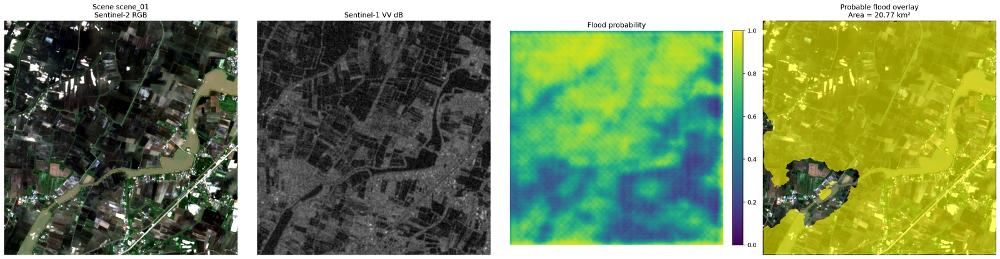
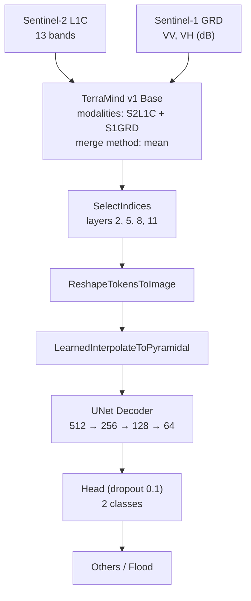
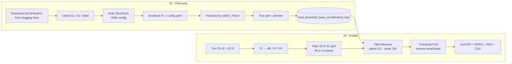

# Flood Mapping with TerraMind (Sentinel-1 + Sentinel-2)

Map **flooded areas** by combining **Sentinel-1 radar** (which sees through clouds) and **Sentinel-2 optical** images,
using the **TerraMind** geospatial foundation model.

The model is fine-tuned on the public **Sen1Floods11** dataset, so **everything in this repo can be reproduced for free**.

> This repo is a **step-by-step guide** for people starting with geospatial foundation models.
> It is the easiest of my repos to begin with, because the dataset is public.

---

## What you get

| Notebook | What it does |
|---|---|
| [`01_finetune_flood_sen1floods11.ipynb`](notebooks/01_finetune_flood_sen1floods11.ipynb) | Download Sen1Floods11 → fine-tune TerraMind → test → save checkpoint |
| [`02_predict_flood_s1_s2.ipynb`](notebooks/02_predict_flood_s1_s2.ipynb) | Use the checkpoint on your own S1 + S2 scenes → flood maps + polygons |

**Prediction output, per scene:**

```text
01_flood_probability.tif         probability 0–1
02_flood_mask_raw.tif            mask after the threshold only
03_flood_mask_clean.tif          mask after cleaning
04_probable_flood_polygons.gpkg  polygons for QGIS / ArcGIS
05_flood_prediction_preview.png  quick preview image for reports
06_scene_metadata.json           scene information
```

Plus `flood_prediction_summary.csv` / `.json` for all scenes (including the flood area in km²).

> **Not included:** the trained checkpoint (`.ckpt`). Run notebook 01 to make your own.

## Results

**Prediction on a real scene** (output of `02_predict_flood_s1_s2.ipynb`, file `05_flood_prediction_preview.png`)



From left to right: Sentinel-2 RGB, Sentinel-1 VV in dB, flood probability (0 to 1), and the probable flood area drawn on the image.

Be honest with your results: in this scene the model marks a large part of the farmland as "probable flood".
The model learned from Sen1Floods11, not from this area, and wet rice fields look a lot like flood water in radar.
This is why the [Limits](#limits-please-read) section below recommends before/after images, a permanent-water mask, and some local labels.

---

## Model architecture

TerraMind reads **two modalities at the same time** and merges them:



| Part | Setting |
|---|---|
| Backbone | `terramind_v1_base` (pretrained) |
| Inputs | `S2L1C` (13 bands) + `S1GRD` (VV, VH) |
| Decoder | `UNetDecoder [512, 256, 128, 64]` |
| Loss | Dice |
| Optimizer | AdamW, lr `2e-5`, weight decay `0.01` |
| Scheduler | CosineAnnealingLR |
| Augmentation | `albumentations.D4` (flips + 90° rotations) |
| Best checkpoint | chosen by **`val/IoU_Flood`** |
| Early stopping | patience 6 |

**Why radar + optical?** Floods come with clouds. Optical images are often blocked by clouds, but radar is not.
Calm water also looks very dark in radar, which makes it easy to spot.

---

## Full workflow



---

## Quick start (Google Colab)

### Step 1: Train (notebook 01)

1. Open it in Colab and choose a **GPU** runtime.
2. Run cell 1 (install). **The runtime restarts by itself.** Then continue from cell 2.
3. Choose the training length:

```python
RUN_MODE = "good"   # "quick" = 5 epochs test · "good" = 20 epochs · "full" = 35 epochs
```

4. Run all. The checkpoint is saved to:

```text
MyDrive/GeoFM_Projects/Flood_Prediction_Package/checkpoints/best_terramind_base_sen1floods11.ckpt
```

### Step 2: Predict (notebook 02)

Prepare your Google Drive like this:

```text
MyDrive/Flood_Prediction_Package/
├── checkpoints/
│   └── best_terramind_base_sen1floods11.ckpt
├── input/
│   └── scenes/
│       ├── scene_01/
│       │   ├── S1.tif
│       │   └── S2.tif
│       └── scene_02/
│           ├── S1.tif
│           └── S2.tif
└── outputs/
```

Then run all cells.

>  The notebook text is written in **Thai**, but the code is in English.

---

## Input format

**S1.tif (Sentinel-1)**

- Best: 2 bands → `Band 1 = VV`, `Band 2 = VH`
- 1 band also works (treated as VV; VH is estimated)
- Linear values are converted to dB automatically

**S2.tif (Sentinel-2)**

- Best: **13 bands** (L1C)
- 4 bands (RGB + NIR) or 3 bands (RGB) also work. The missing bands are filled with the Sen1Floods11 mean.
- S2 is re-projected to the S1 grid automatically

**Area calculation CRS:** `EPSG:32647` (UTM zone 47N, Thailand). Change `AREA_CRS` for your country.

---

## Main prediction settings

| Setting | Default | Meaning |
|---|---|---|
| `PATCH_SIZE` | 512 | Window size |
| `STRIDE` | 256 | 50% overlap |
| `FLOOD_THRESHOLD` | 0.55 | Probability to call a pixel "flood" |
| `MIN_COMPONENT_PIXELS` | 30 | Remove tiny blobs |
| `MIN_POLYGON_AREA_M2` | 1000 | Remove tiny polygons |
| `AREA_CRS` | EPSG:32647 | CRS used to calculate the area |

---

## Limits (please read)

The model learned from **Sen1Floods11**, not from your area.
So in a new area, treat the result as a **"probable flood" prototype**, not an official flood map.

**For better results:**

1. Use real Sentinel-1 **VV + VH**
2. Use real Sentinel-2 L1C with **13 bands**
3. Compare **before-flood and after-flood** images
4. Remove **permanent water** (rivers, lakes)
5. Add a **DEM / slope** mask
6. Label a few local areas and fine-tune again

---

## Common problems

| Problem | Fix |
|---|---|
| No GPU found | Runtime → Change runtime type → GPU |
| Import error right after install | That is normal. The runtime restarts. Start again from cell 2 |
| `pip` wants to change PyTorch | The notebook installs TerraTorch with `--no-deps` on purpose |
| Out of memory on T4 | Keep `BATCH_SIZE=2` + `ACCUMULATE_GRAD_BATCHES=4` |
| Too much / too little flood | Change `FLOOD_THRESHOLD` (0.45–0.65) |

---

## Learn more

- [Beginner's guide to GeoFM and TerraMind](docs/GEOFM_BEGINNER_GUIDE.md)
- Sen1Floods11 dataset: https://github.com/cloudtostreet/Sen1Floods11
- TerraMind model: https://huggingface.co/ibm-esa-geospatial/TerraMind-1.0-base
- TerraTorch: https://github.com/torchgeo/terratorch

## Related repos

Part of my geospatial foundation model series:
- [Building footprint (THEOS-2)](https://github.com/mastersungx1/terramind-building-footprint-theos2)
- [Rice mapping (Sentinel-2 time series)](https://github.com/mastersungx1/terramind-rice-mapping-sentinel2)
- [Flood mapping (Sentinel-1 + 2)](https://github.com/mastersungx1/terramind-flood-mapping-sen1floods11)
- [Road extraction (THEOS-2)](https://github.com/mastersungx1/theos2-road-extraction-multitask)

## Acknowledgement

Developed during my internship at **I-bitz (Insight)**. Thank you to the team for the support and for allowing me to share this work.
The company's data, labels and trained checkpoints are **not** part of this repository.

## License

Code: [MIT](LICENSE). Sen1Floods11, TerraMind and TerraTorch have their own licenses.
